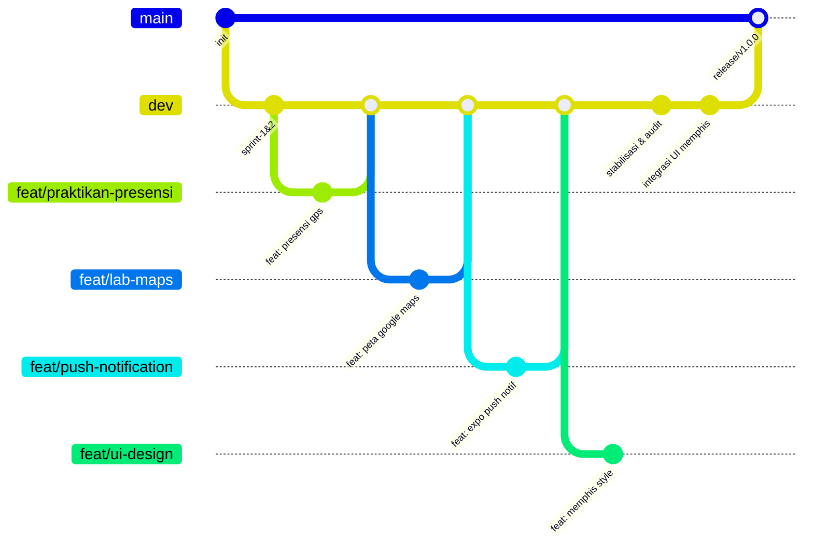
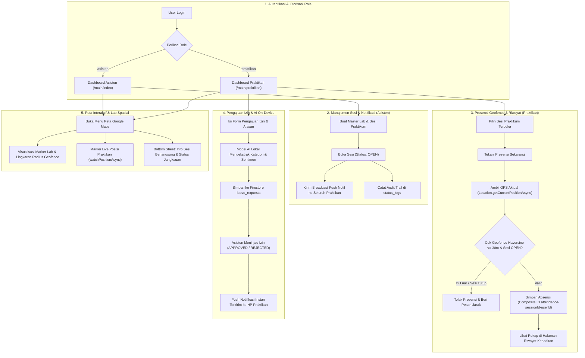

# 📱 Lab Session Manager

> **Sistem Manajemen Sesi Praktikum, Presensi Geofencing GPS, Peta Spasial Interaktif, dan Rekapitulasi Berbasis Mobile (React Native / Expo SDK 58).**

Aplikasi mobile komprehensif untuk mengelola kegiatan laboratorium praktikum informatika secara real-time. Dilengkapi validasi radius lokasi (Geofencing Haversine), peta laboratorium interaktif (Google Maps), model AI lokal (*on-device*) untuk ekstraksi dan sentimen permohonan izin, push notification instan, serta sinkronisasi Cloud Firestore.

---

## 📑 Daftar Isi

- [Ringkasan & Arsitektur Sistem](#-ringkasan--arsitektur-sistem)
- [Fitur Utama Berdasarkan Sprint](#-fitur-utama-berdasarkan-sprint)
- [Teknologi yang Digunakan](#-teknologi-yang-digunakan)
- [Workflow Final Pengembangan & Git](#-workflow-final-pengembangan--git)
- [Alur Kerja Sistem (End-to-End User Flow)](#-alur-kerja-sistem-end-to-end-user-flow)
- [Matriks Keterlacakan SRS (SRS Traceability Matrix)](#-matriks-keterlacakan-srs-srs-traceability-matrix)
- [Panduan Instalasi & Menjalankan Proyek](#-panduan-instalasi--menjalankan-proyek)
- [Pengujian Otomatis & Kontrol Kualitas](#-pengujian-otomatis--kontrol-kualitas)
- [Struktur Direktori Proyek](#-struktur-direktori-proyek)

---

## 🏛 Ringkasan & Arsitektur Sistem

Aplikasi ini mengadopsi arsitektur modular yang menggabungkan:
1. **Frontend Mobile:** React Native & Expo Router dengan sistem navigasi berbasis peran (*role-based gatekeeper*).
2. **Desain Antarmuka:** Memphis Modern Navy & Ice Blue dengan komponen visual reusable.
3. **Backend & Database:** Firebase Authentication dan Cloud Firestore dengan dual-layer architecture (`@react-native-firebase` di Android/iOS dan Web SDK fallback).
4. **Geolocation Engine:** Sensor lokasi perangkat (`expo-location`) dan formula trigonometri Haversine untuk kalkulasi jarak radius presensi.
5. **On-Device AI Engine:** Model klasifikasi teks murni JavaScript tanpa ketergantungan API eksternal untuk analisis sentimen izin dan ekstraksi kategori izin praktikum.
6. **Notification Engine:** Layanan push notification terpusat melalui Expo Notification API.

---

## 🚀 Fitur Utama Berdasarkan Sprint

### 🔹 Sprint 1: Antarmuka Dasar & Logika Sesi
* **Autentikasi & Navigasi Peran:** Pemisahan hak akses antara **Asisten Lab** dan **Praktikan**.
* **Manajemen Sesi Lokal:** Asisten dapat membuat, membuka (`OPEN`), dan menutup (`CLOSED`) sesi praktikum.
* **Pencatatan Presensi:** Praktikan dapat melakukan presensi pada sesi aktif dengan pencegahan presensi berulang.
* **Rekapitulasi Kehadiran:** Daftar riwayat kehadiran personal bagi praktikan dan rekap seluruh praktikan bagi asisten.

### 🔹 Sprint 2: Cloud Firestore, Keamanan & AI On-Device
* **CRUD Realtime Firestore:** Pengelolaan Kelas (`classes`), Jadwal (`schedules`), dan Sesi (`sessions`).
* **Session Lifecycle & Audit Logs:** Audit trail otomatis setiap transisi status sesi pada koleksi `status_logs`.
* **Modul Perizinan Praktikum:** Praktikan mengajukan izin (`leave_requests`), asisten meninjau (`APPROVED`/`REJECTED`).
* **Model AI On-Device:** Analisis alasan izin praktikan secara offline untuk mengekstrak kategori (`SAKIT`, `DISPENSASI`, `IZIN_AKADEMIK`, `LAINNYA`) dan analisis polaritas sentimen.
* **Firestore Security Rules:** Pembatasan hak baca-tulis dokumen berbasis UID dan otorisasi peran asisten.

### 🔹 Sprint 3: Geofencing GPS, Google Maps & Push Notification
* **Validasi Presensi Geofence:** Menghitung jarak presisi fisik praktikan ke laboratorium tujuan via Rumus Haversine (toleransi 30 meter). Presensi di luar radius atau pada sesi tertutup otomatis ditolak.
* **Peta Interaktif Google Maps:** Halaman peta spasial menampilkan marker seluruh lab, visualisasi lingkaran radius geofence, dan marker posisi pengguna real-time (*live pulse*).
* **Lab Activity Sheet:** Bottom sheet interaktif menampilkan sesi yang sedang berjalan, jadwal berikutnya, serta estimasi jarak live ke lab.
* **Push Notification Otomatis:**
  * Broadcast instan ke perangkat praktikan saat sesi praktikum dibuka.
  * Notifikasi personal ke praktikan saat pengajuan izin disetujui atau ditolak oleh asisten.

---

## 🛠 Teknologi yang Digunakan

| Kategori | Teknologi | Versi | Keterangan |
| :--- | :--- | :--- | :--- |
| **Framework Mobile** | React Native / Expo | `SDK 58.0.26` | Framework utama mobile cross-platform |
| **Bahasa Pemrograman** | TypeScript | `^5.3.3` | Static typing ketat (strict mode) |
| **Navigasi & Routing** | Expo Router | `~58.0.0` | File-based routing dengan proteksi layout |
| **Database & Auth** | Firebase Auth & Firestore | `Native ^27.1.1` / `Web ^13.2.0` | Sinkronisasi real-time & persistent offline |
| **Peta Spasial** | `react-native-maps` | `1.18.0` | Peta Google Maps interaktif Android/iOS |
| **Sensor Lokasi** | `expo-location` | `~19.0.8` | GPS satelit & foreground geofence service |
| **Push Notification** | `expo-notifications` | `~0.32.0` | Notifikasi remote & background handlers |
| **AI Classifier** | Pure JavaScript Engine | Custom | Analisis sentimen lokal berbasis kamus EDOM |
| **Komponen Visual** | `react-native-svg` & `@expo/vector-icons` | `15.16.0` / `^15.0.2` | Elemen grafis Memphis & ikon sistem |

---

## 🌿 Workflow Final Pengembangan & Git

Pengembangan proyek mengikuti standar Git dan branching model terstruktur:



### 1. Cabang Repository (Branching)
* **`main`**: Versi produksi stabil (*release ready*).
* **`dev`**: Cabang integrasi aktif tempat semua fitur disatukan dan diaudit.
* **`feat/...`**: Cabang fitur spesifik tiap modul pengembang (`feat/praktikan-presensi`, `feat/lab-maps-integration`, `feat/push-notification-event`, `feat/ui-design`).

### 2. Konvensi Commit (Bahasa Indonesia Natural & Imperatif)
Format: `<type>(<scope>): <deskripsi singkat>`
* Menggunakan kata kerja imperatif: `tambah`, `perbaiki`, `stabilkan`, `integrasikan`, `rapikan`.
* Huruf kecil tanpa titik di akhir.
* Contoh:
  * `chore: stabilkan fitur sprint dan aturan keamanan`
  * `feat(ui): integrasikan desain memphis modern dan komponen visual baru`
  * `fix(presensi): perbaiki validasi radius lokasi lab`

### 3. Gerbang Kualitas (Quality Gate)
Setiap perubahan wajib lolos 4 pemeriksaan sebelum commit/push:
```bash
npx tsc --noEmit          # Validasi tipe data TypeScript (0 error)
npx expo lint             # Validasi kode linter (0 warning, 0 error)
npx expo-doctor           # Validasi kecocokan dependensi native Expo (20/20 lulus)
node scripts/verify-all.js # Suite uji otomatis 32 skenario bisnis (100% lulus)
```

---

## 🔄 Alur Kerja Sistem (End-to-End User Flow)



---

## 📊 Matriks Keterlacakan SRS (SRS Traceability Matrix)

Berikut adalah pemetaan kebutuhan sistem (*Software Requirements Specification*) terhadap file implementasi dan hasil verifikasinya:

| ID Kebutuhan | Nama & Deskripsi Kebutuhan | File Implementasi | Status | Bukti Pengujian |
| :--- | :--- | :--- | :---: | :--- |
| **SRS-F01** | Autentikasi Pengguna & Penguncian Role | `src/context/auth-context.tsx`<br>`src/components/auth-form.tsx` | **Lulus** | Login, register, proteksi rute berjalan normal |
| **SRS-F02** | Proteksi Navigasi Peran (Gatekeeper) | `src/app/(main)/_layout.tsx` | **Lulus** | Praktikan dicegah mengakses rute asisten |
| **SRS-F03** | Manajemen Kelas, Jadwal & Sesi Praktikum | `src/context/session-context.tsx`<br>`src/components/asisten/*` | **Lulus** | CRUD data Firestore berjalan atomik |
| **SRS-F04** | Session Lifecycle & Audit Trail | `src/context/session-context.tsx` | **Lulus** | Uji otomatis transisi `OPEN`/`CLOSED` & `status_logs` |
| **SRS-F05** | Ekstraksi AI & Sentimen Izin On-Device | `src/services/ai-sentiment.ts`<br>`ai/sentiment.js` | **Lulus** | Kategori `SAKIT`, `DISPENSASI`, `IZIN_AKADEMIK` terdeteksi offline |
| **SRS-F06** | Aturan Keamanan Database Firestore | `firestore.rules` | **Lulus** | 10 aturan kecocokan koleksi & role-check terverifikasi |
| **SRS-01** | Halaman Presensi Terpisah Praktikan | `src/app/(main)/praktikan/[id].tsx` | **Lulus** | Rute dinamis berbasis ID sesi dengan validasi status |
| **SRS-02** | Hook Sensor Geolocation & Izin Lokasi | `src/hooks/use-location.ts`<br>`src/app/(main)/praktikan/[id].tsx` | **Lulus** | GPS akurasi tinggi dan permission handling |
| **SRS-03** | Perhitungan Jarak Rumus Haversine | `src/utils/attendance-location.ts` | **Lulus** | Kalkulasi jarak meter presisi desimal teruji |
| **SRS-04** | Validasi Geofence Radius Lab (30 Meter) | `src/context/session-context.tsx` | **Lulus** | Presensi di luar radius atau sesi CLOSED ditolak |
| **SRS-05** | Pencegahan Presensi Ganda | `src/context/session-context.tsx` | **Lulus** | Composite ID `attendance-${sessionId}-${userId}` mencegah duplikasi |
| **SRS-06** | Presensi Alternatif QR Code Sesi | `src/components/asisten/session-qr-modal.tsx`<br>`src/components/praktikan/PresensiModal.tsx` | **Lulus** | QR modal dan scanner terintegrasi |
| **SRS-07** | CRUD Master Laboratorium & Koordinat | `src/services/firestore-service.ts`<br>`src/components/asisten/lab-form-modal.tsx` | **Lulus** | Pencocokan nama lab, kode lab, dan fuzzy match teruji |
| **SRS-08** | Peta Laboratorium Interaktif Google Maps | `src/app/(main)/maps.tsx`<br>`src/components/maps/lab-marker.tsx` | **Lulus** | Render marker lab, status live, dan radius lingkaran geofence |
| **SRS-09** | Marker Posisi Live Pengguna Real-Time | `src/components/maps/user-marker.tsx`<br>`src/hooks/use-location.ts` | **Lulus** | Pelacakan `watchPositionAsync` efisien baterai |
| **SRS-10** | Bottom Sheet Aktivitas Laboratorium | `src/components/maps/lab-activity-sheet.tsx` | **Lulus** | Menampilkan sesi aktif, jadwal, jarak live, dan tombol pintas |
| **SRS-11** | Sinkronisasi Peta Real-Time dengan Firestore | `src/context/session-context.tsx` | **Lulus** | Status peta otomatis terbarui saat sesi dibuka di perangkat lain |
| **SRS-12** | Antarmuka Cadangan (*Fallback List*) Peta | `src/components/maps/map-fallback-list.tsx` | **Lulus** | Daftar kartu lab aktif saat GPS/Google Maps tidak tersedia |
| **SRS-13** | Setup Android Notification Channel & Token | `src/services/notification-service.ts`<br>`src/context/auth-context.tsx` | **Lulus** | Saluran notifikasi prioritas tinggi & sinkronisasi token user |
| **SRS-14** | Notification Handlers & Deep Linking | `src/services/notification-service.ts`<br>`src/app/_layout.tsx` | **Lulus** | Navigasi otomatis saat banner notifikasi diklik |
| **SRS-15** | Pemicu Push Broadcast Saat Sesi Dibuka | `src/context/session-context.tsx` | **Lulus** | Broadcast payload terkirim saat status sesi menjadi `OPEN` |
| **SRS-16** | Pemicu Push Notifikasi Keputusan Izin | `src/context/session-context.tsx` | **Lulus** | Notifikasi persetujuan/penolakan izin dengan catatan asisten |

---

## 💻 Panduan Instalasi & Menjalankan Proyek

### 1. Prasyarat Sistem
* Node.js v18 atau v20+
* NPM / Bun
* Expo CLI (`npx expo`)
* Akun Firebase & Google Cloud Platform (untuk API Google Maps)

### 2. Kloning Repository & Instal Dependensi
```bash
git clone https://github.com/dianberlianhutasoit/lab-session-manager.git
cd lab-session-manager
npm install
```

### 3. Konfigurasi Environment Variable (`.env`)
Salin file `.env.example` menjadi `.env` lalu sesuaikan kredensial Anda:
```env
EXPO_PUBLIC_FIREBASE_API_KEY=your_firebase_api_key
EXPO_PUBLIC_FIREBASE_AUTH_DOMAIN=your_project.firebaseapp.com
EXPO_PUBLIC_FIREBASE_PROJECT_ID=your_project_id
EXPO_PUBLIC_FIREBASE_STORAGE_BUCKET=your_project.appspot.com
EXPO_PUBLIC_FIREBASE_MESSAGING_SENDER_ID=your_sender_id
EXPO_PUBLIC_FIREBASE_APP_ID=your_app_id
EXPO_PUBLIC_GOOGLE_MAPS_API_KEY=your_google_maps_api_key
```

### 4. Menjalankan Aplikasi
```bash
# Menjalankan Metro Bundler
npx expo start

# Menjalankan langsung di Emulator / Device Android
npx expo run:android

# Menjalankan di Web Browser
npx expo start --web
```

---

## 🧪 Pengujian Otomatis & Kontrol Kualitas

Proyek ini dilengkapi script verifikasi otomatis menyeluruh untuk memastikan tidak ada regresi logika bisnis:

```bash
# Menjalankan seluruh pengujian fungsionalitas
node scripts/verify-all.js
```

**Cakupan Pengujian `verify-all.js` (32 Skenario):**
1. **Geofence & Haversine:** Perhitungan koordinat identik (0m), dalam radius toleransi (7.5m < 30m), dan luar radius (106.7m > 30m).
2. **Pencocokan Ruangan & Lab:** Exact ID match, case-insensitive, pencocokan kode lab (LK-01), dan pencocokan fuzzy substring.
3. **Validasi Presensi & Anti-Duplikasi:** Composite key record, penolakan presensi ganda, penolakan sesi CLOSED, dan penolakan luar geofence.
4. **Lifecycle Sesi & Audit Log:** Timestamp buka sesi, pencatatan log OPEN dengan UID actor, timestamp tutup sesi, dan pencatatan log CLOSED.
5. **Model AI Lokal:** Klasifikasi teks `SAKIT`, `DISPENSASI`, `IZIN_AKADEMIK`, dan sentiment analyzer polaritas.
6. **Payload Push Notification:** Validasi skema payload broadcast sesi dan keputusan izin.
7. **Integritas Firestore Rules:** Validasi ekspresi keamanan untuk 9 koleksi dokumen dan otorisasi role asisten.

---

## 📁 Struktur Direktori Proyek

```text
lab-session-manager/
├── ai/                              # Model & kamus kata AI on-device
│   ├── model-edom.json
│   └── sentiment.js
├── scripts/                         # Script otomasi & testing
│   └── verify-all.js                # Suite uji 32 skenario bisnis
├── src/
│   ├── app/                         # Rute halaman (Expo Router)
│   │   ├── (auth)/                  # Rute login & register
│   │   ├── (main)/                  # Rute utama aplikasi
│   │   │   ├── praktikan/           # Dashboard, riwayat & presensi praktikan
│   │   │   ├── index.tsx            # Dashboard Asisten Lab
│   │   │   ├── maps.tsx             # Peta interaktif Google Maps
│   │   │   └── _layout.tsx          # Role-based navigation gatekeeper
│   │   └── _layout.tsx              # Root layout & push notification listener
│   ├── components/                  # Komponen UI reusable
│   │   ├── asisten/                 # Modal CRUD kelas, sesi, jadwal, lab & QR
│   │   ├── common/                  # Banner notifikasi & dialog konfirmasi
│   │   ├── izin/                    # Form pengajuan & review permohonan izin
│   │   ├── maps/                    # Marker lab, user marker & activity sheet
│   │   ├── praktikan/               # SessionCard & modal presensi
│   │   ├── MemphisHeader.tsx        # Header dekoratif SVG Memphis
│   │   ├── PillButton.tsx           # Tombol kapsul bergaya Memphis
│   │   └── UnderlineInput.tsx       # Input form garis minimalis
│   ├── constants/                   # Token warna (theme.ts), lab dummy & icon
│   ├── context/                     # State management (auth & session)
│   ├── hooks/                       # Custom hooks (use-location, dll.)
│   ├── services/                    # Firebase, Firestore, Notifikasi & AI
│   ├── types/                       # Definisi antarmuka TypeScript
│   └── utils/                       # Utility Haversine & Geofence GPS
├── app.json                         # Konfigurasi Expo & manifest Android/iOS
├── firestore.rules                  # Aturan keamanan Cloud Firestore
├── git_workflow.md                  # Panduan workflow Git & konvensi commit
├── sprint.md                        # Dokumentasi roadmap sprint & pembagian tugas
└── package.json                     # Daftar pustaka & dependensi proyek
```

---

## 👥 Kontributor & Tim Pengembang

Proyek ini dikembangkan oleh Tim Praktikum Pengembangan Perangkat Lunak (PPK):
* **Programmer 1:** Presensi Berbasis Lokasi, Geofencing Haversine & Rekap Kehadiran (SRS-01 s/d SRS-06).
* **Programmer 2:** Pengelolaan Master Lab, Peta Google Maps & Aktivitas Spasial (SRS-07 s/d SRS-12).
* **Programmer 3:** Push Notification Engine, Android Channels & Pemicu Event (SRS-13 s/d SRS-16).

---

*© 2026 Lab Session Manager — Dikembangkan dengan standar kode bersih, keandalan fungsional, dan performa tinggi.*
