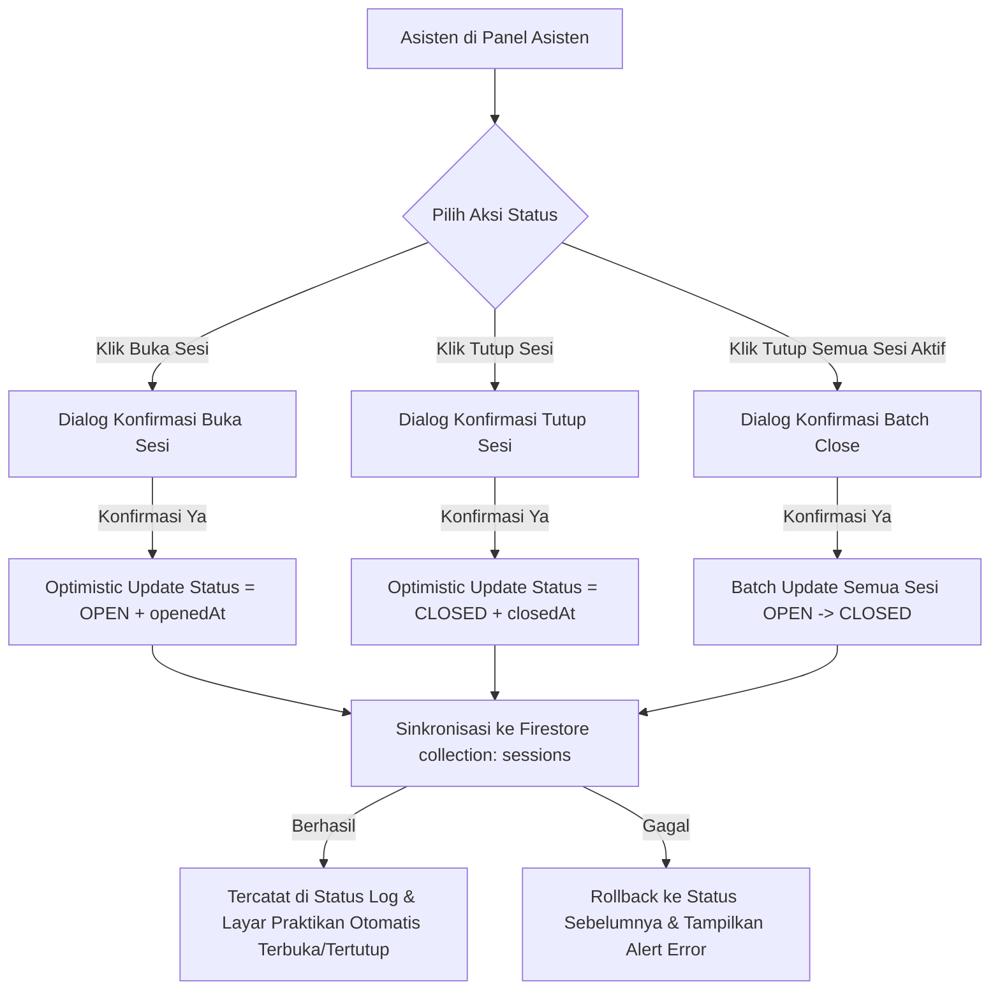

# Rencana Implementasi SRS-08: Kontrol Status Pembukaan/Penutupan Sesi (`OPEN` / `CLOSED`)

Dokumen ini berisi analisis kondisi kode saat ini, celah fungsional yang perlu dilengkapi, rancangan model data, struktur kode, dan komponen untuk mengimplementasikan **SRS-08** pada cabang `feat/asisten-srs-08-status-sesi`.

---

## 1. Analisis Kondisi Kode Saat Ini (Current State)

Berdasarkan pemeriksaan kode hasil fondasi SRS-07:

1. **Fungsi Dasar yang Sudah Ada**:
   - Tipe `SessionStatus = "OPEN" | "CLOSED"` sudah terdefinisi di `src/types/index.ts`.
   - `SessionContext` (`src/context/session-context.tsx`) sudah memiliki fungsi dasar `openSession`, `closeSession`, dan `toggleSessionStatus`.
   - `firestore-service.ts` sudah memiliki fungsi `firestoreUpdateSessionStatus(sessionId, status)`.
   - Layar Praktikan (`src/app/praktikan/[id].tsx`) sudah membaca `session.status === "OPEN"` untuk mengaktifkan/menonaktifkan tombol **"Lakukan Presensi"**.

2. **Celah Fungsional & Teknis yang Belum Ada (Target SRS-08)**:
   - **Metadata Waktu & Audit Sesi**: Entitas `Session` belum mencatat kapan sesi dibuka (`openedAt`), kapan sesi ditutup (`closedAt`), serta siapa asisten yang melakukan aksi (`lastStatusChangedBy`).
   - **Inkonsistensi Konfirmasi di Modal Detail**: Pada `SessionDetailModal` (`src/components/asisten/session-detail-modal.tsx`), tombol **"Buka/Tutup Sesi Sekarang"** langsung mengubah status tanpa dialog konfirmasi (berbeda dengan `SessionCard`).
   - **Penanganan Async, Loading State, & Error Rollback Firestore**: Fungsi `openSession`, `closeSession`, dan `toggleSessionStatus` di `SessionContext` belum bersifat `async` terproteksi (belum ada *loading state* per sesi saat request ke Firestore berjalan, dan belum ada *rollback* jika update ke Firestore gagal).
   - **Kontrol Massal / Quick Action Panel**: Belum ada fitur **Quick Status Control** di halaman utama asisten (misalnya indikator sesi yang sedang aktif/terbuka saat ini beserta tombol cepat **"Tutup Semua Sesi Terbuka"** setelah jam praktikum berakhir).
   - **Riwayat Aktivitas Status (Status Audit Trail)**: Belum ada pencatatan/tampilan riwayat perubahan status (`OPEN` <-> `CLOSED`) di dalam detail sesi.

---

## 2. Ruang Lingkup Pekerjaan (Scope of Work SRS-08)

1. **Peningkatan Model Data Sesi (`Session` & `SessionStatusLog`)**:
   - Menambahkan atribut `openedAt?: string`, `closedAt?: string`, dan `lastUpdatedBy?: string` pada `Session`.
   - Menambahkan tipe `SessionStatusLog` untuk mencatat riwayat waktu pembukaan dan penutupan sesi oleh asisten.
2. **Penguatan Logika Kontrol Status di Context & Firestore**:
   - Memperbarui `openSession`, `closeSession`, dan `toggleSessionStatus` menjadi operasi asynchronous yang:
     - Menyimpan timestamp `openedAt` (saat dibuka) atau `closedAt` (saat ditutup) ke state dan koleksi `sessions` di Firestore.
     - Menyimpan jejak asisten (`currentAssistantId` / asisten pengampu) yang mengubah status.
     - Menyediakan state `updatingSessionIds: string[]` untuk menampilkan indikator loading & mencegah *double-click* saat proses update ke Firestore berlangsung.
     - Melakukan *automatic rollback* apabila koneksi/penulisan ke Firestore gagal.
   - Menambahkan fungsi `closeAllOpenSessions()` untuk menutup seluruh sesi yang masih berstatus `OPEN` sekaligus (menggunakan Firestore `writeBatch`).
3. **Komponen UI Kontrol Status Sesi**:
   - **`ActiveSessionsControlBanner` (`src/components/asisten/active-sessions-banner.tsx`)**:
     - Panel khusus di bagian atas tab Jadwal Sesi yang menyorot sesi-sesi yang sedang berstatus `OPEN` secara real-time, lengkap dengan waktu sejak dibuka (`openedAt`) dan tombol aksi cepat **"Tutup Semua Sesi"** atau tutup per sesi.
   - **Pembaruan `SessionStatusBadge` (`src/components/asisten/session-status-badge.tsx`)**:
     - Menambahkan opsi indikator waktu/status transisi (`Memperbarui...`) saat sesi sedang disinkronkan ke Firestore.
   - **Pembaruan `SessionCard` & `SessionDetailModal`**:
     - Menampilkan informasi waktu `Dibuka pada: HH:mm` (jika status `OPEN`) atau `Ditutup pada: HH:mm` (jika sudah pernah dibuka lalu ditutup).
     - Menyeragamkan dialog konfirmasi Buka/Tutup Sesi di `SessionCard` maupun `SessionDetailModal`.
     - Menambahkan bagian **Log Status Sesi** di dalam `SessionDetailModal`.

---

## 3. Rancangan Perubahan Model Data (`src/types/index.ts`)

```typescript
export interface Session {
  id: string;
  classId?: string;
  scheduleId: string;
  assistantId: string;
  status: SessionStatus;
  openedAt?: string;           // [BARU - SRS-08] Timestamp ISO saat sesi terakhir dibuka
  closedAt?: string;           // [BARU - SRS-08] Timestamp ISO saat sesi terakhir ditutup
  lastUpdatedBy?: string;      // [BARU - SRS-08] ID asisten yang terakhir mengubah status
  createdAt?: string;
  updatedAt?: string;
}

/**
 * SRS-08: Riwayat perubahan status sesi (OPEN / CLOSED)
 */
export interface SessionStatusLog {
  id: string;
  sessionId: string;
  previousStatus: SessionStatus;
  newStatus: SessionStatus;
  changedBy: string;
  changedAt: string;
}
```

---

## 4. Rancangan Perubahan Service & Context

### A. `src/services/firestore-service.ts`
- Memperbarui `firestoreUpdateSessionStatus`:
  ```typescript
  export async function firestoreUpdateSessionStatus(
    sessionId: string,
    status: SessionStatus,
    metadata?: {
      openedAt?: string;
      closedAt?: string;
      lastUpdatedBy?: string;
    }
  ): Promise<void>
  ```
- Menambahkan `firestoreBatchCloseSessions(sessionIds: string[], closedBy: string): Promise<void>` menggunakan `writeBatch(db)`.

### B. `src/context/session-context.tsx`
- Menambahkan state & fungsi baru:
  - `statusLogs: SessionStatusLog[]`
  - `updatingSessionIds: string[]` (daftar ID sesi yang sedang dalam proses update status)
  - `openSession: (sessionId: string) => Promise<boolean>`
  - `closeSession: (sessionId: string) => Promise<boolean>`
  - `toggleSessionStatus: (sessionId: string) => Promise<boolean>`
  - `closeAllOpenSessions: (assistantIdFilter?: string) => Promise<number>`
  - `getSessionStatusLogs: (sessionId: string) => SessionStatusLog[]`

---

## 5. Struktur Kode & File yang Akan Dibuat / Diubah

```text
src/
├── types/
│   └── index.ts                                       # [MODIFIKASI] Tambah openedAt, closedAt, lastUpdatedBy, SessionStatusLog
├── data/
│   └── dummy.ts                                       # [MODIFIKASI] Tambah metadata openedAt/closedAt pada data dummy awal
├── services/
│   └── firestore-service.ts                           # [MODIFIKASI] Update firestoreUpdateSessionStatus & tambah batch close
├── context/
│   └── session-context.tsx                            # [MODIFIKASI] Async status control, rollback error, statusLogs, closeAllOpenSessions
├── components/
│   └── asisten/
│       ├── active-sessions-banner.tsx                 # [BARU] Banner kontrol cepat sesi yang sedang OPEN + tombol Tutup Semua
│       ├── session-status-badge.tsx                   # [MODIFIKASI] Dukungan loading state & tampilan status reaktif
│       ├── session-card.tsx                           # [MODIFIKASI] Tampilkan info waktu dibuka/ditutup & disable tombol saat loading
│       └── session-detail-modal.tsx                   # [MODIFIKASI] Konfirmasi buka/tutup sesi + tampilan riwayat log status sesi
└── app/
    └── index.tsx                                      # [MODIFIKASI] Integrasi ActiveSessionsControlBanner & feedback status sesi
```

---

## 6. Alur Kerja Pengguna (User Flow SRS-08)



---

## 7. Rencana Verifikasi & Pengujian

1. **Buka Sesi (`CLOSED` -> `OPEN`)**:
   - Klik **Buka Sesi** pada kartu sesi atau modal detail -> Konfirmasi -> Pastikan badge berubah menjadi `SESI DIBUKA`, waktu `Dibuka pukul HH:mm` muncul, dan sesi masuk ke `ActiveSessionsControlBanner`.
   - Cek di halaman **Praktikan** (`src/app/praktikan/[id].tsx`) -> pastikan tombol **"Lakukan Presensi"** langsung aktif.
2. **Tutup Sesi (`OPEN` -> `CLOSED`)**:
   - Klik **Tutup Sesi** -> Konfirmasi -> Pastikan badge berubah menjadi `SESI DITUTUP`, waktu `Ditutup pukul HH:mm` tercatat, dan di halaman **Praktikan** tombol presensi otomatis terkunci kembali (**"Sesi Tidak Terbuka"**).
3. **Tutup Semua Sesi Terbuka (Batch Control)**:
   - Jika ada 1 atau lebih sesi berstatus `OPEN`, klik tombol **"Tutup Semua Sesi"** pada banner kontrol aktif -> pastikan seluruh sesi tertutup sekaligus.
4. **Kualitas Kode**:
   - Jalankan `npx tsc --noEmit` (0 error).
   - Jalankan `npx eslint .` (0 error, 0 warning).

---

## 8. Keputusan Konfirmasi Desain (Disetujui User)

1. **Otorisasi & Peringatan Asisten Pengampu (Opsi B)**:
   - Jika asisten yang sedang aktif dipilih berbeda dengan asisten penanggung jawab sesi (`session.assistantId`), sistem akan menampilkan **peringatan khusus** pada dialog konfirmasi (*"Perhatian: Sesi ini ditugaskan kepada [Nama Asisten]. Apakah Anda yakin ingin tetap membuka/menutup sesi ini sebagai asisten pengganti?"*) dan mencatat identitas asisten yang melakukan perubahan di `SessionStatusLog`.
2. **Banner Kontrol Sesi Aktif (`ActiveSessionsControlBanner`)**:
   - Ditambahkan di bagian atas daftar Jadwal Sesi untuk menampilkan daftar sesi yang sedang berstatus `OPEN` beserta waktu pembukaannya (`openedAt`) dan tombol aksi cepat **"Tutup Semua Sesi"**.
3. **Sesi Terbuka Bersamaan**:
   - Diperbolehkan terdapat beberapa sesi berstatus `OPEN` secara bersamaan (untuk mengakomodasi kelas/ruangan berbeda yang berjalan paralel).

