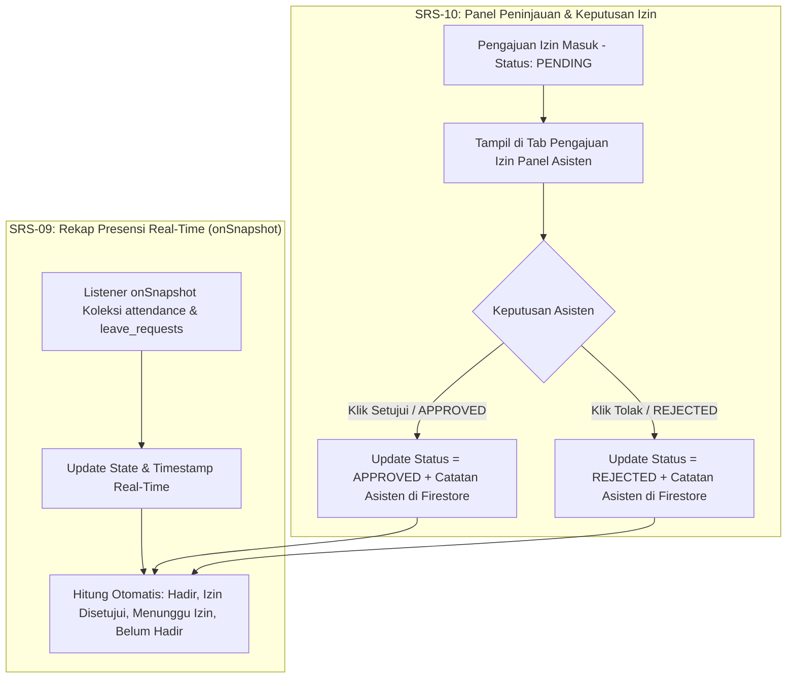

# Rencana Implementasi SRS-09 & SRS-10: Rekap Presensi Real-Time (`onSnapshot`) & Panel Peninjauan Izin (`APPROVED` / `REJECTED`)

Dokumen ini berisi analisis kondisi kode saat ini, rancangan model data, struktur file, dan rencana komponen untuk mengimplementasikan **SRS-09** dan **SRS-10** secara terpadu pada cabang `feat/asisten-srs-09-10-rekap-izin`.

---

## 1. Analisis Kondisi Kode Saat Ini (Current State)

Berdasarkan pemeriksaan kode pada layar **Rekap Presensi (`src/app/explore.tsx`)** dan komponen di `src/components/asisten/`:

1. **Kondisi SRS-09 (Rekap Presensi Real-Time berbasis `onSnapshot`)**:
   - Halaman `src/app/explore.tsx` sudah memiliki pemilih sesi horizontal, kartu ringkasan (`AttendanceSummaryCards`), kolom pencarian, serta daftar praktikan **Hadir (`PRESENT`)** dan **Belum Hadir (`ABSENT`)**.
   - **Yang perlu dilengkapi untuk SRS-09**:
     - Belum ada listener real-time spesifik per sesi (`subscribeToSessionAttendance(sessionId, ...)` dengan `query(..., where('sessionId', '==', sessionId))` & `onSnapshot`) beserta indikator status **Live Stream `onSnapshot`** dan timestamp pembaruan terakhir (`lastSyncedAt`).
     - Ringkasan statistik belum memperhitungkan praktikan yang **Izin Disetujui (`APPROVED`)** maupun **Menunggu Konfirmasi Izin (`PENDING`)**.
     - Belum ada fitur bagi asisten untuk **mencatat/mensimulasikan presensi praktikan secara langsung** dari panel apabila praktikan mengalami kendala perangkat.

2. **Kondisi SRS-10 (Panel Peninjauan & Keputusan Izin - `APPROVED` / `REJECTED`)**:
   - **Belum ada sama sekali** di codebase saat ini:
     - Belum ada tipe data `LeaveRequest` (Pengajuan Izin), `LeaveStatus` (`PENDING` | `APPROVED` | `REJECTED`), maupun `LeaveCategory` (`SAKIT` | `DISPENSASI` | `IZIN_AKADEMIK` | `LAINNYA`).
     - Belum ada koleksi Firestore `leave_requests` beserta fungsi real-time `onSnapshot` dan mutasi `reviewLeaveRequest` (`APPROVED` / `REJECTED`).
     - Belum ada Tab/Panel **Peninjauan Izin** di `src/app/explore.tsx`, kartu pengajuan izin (`LeaveRequestCard`), maupun modal detail peninjauan & pembuatan pengajuan izin (`LeaveReviewModal` / `LeaveFormModal`).

---

## 2. Ruang Lingkup Pekerjaan (Scope of Work SRS-09 & SRS-10)

### A. SRS-09: Rekap Presensi Real-Time Berbasis `onSnapshot`
1. **Real-Time Listener Spesifik Sesi (`onSnapshot`)**:
   - Berlangganan langsung ke koleksi `attendance` dan `leave_requests` di Firestore menggunakan `onSnapshot`.
   - Menampilkan badge indikator **`🟢 Real-Time onSnapshot Aktif`** beserta waktu sinkronisasi terakhir (`Diperbarui: HH:mm:ss WIB`) dan penghitung event perubahan real-time.
2. **Integrasi Status Kehadiran 3 Kategori**:
   - **Hadir (`PRESENT`)**: Praktikan yang tercatat di `attendance`.
   - **Izin (`PERMIT`)**: Praktikan yang mengajukan izin (`PENDING`, `APPROVED`, `REJECTED`). Praktikan dengan izin `APPROVED` tidak lagi dihitung sebagai Alpa/Belum Hadir.
   - **Belum Hadir (`ABSENT`)**: Praktikan terdaftar yang belum presensi dan tidak memiliki izin berstatus `APPROVED`.
3. **Pencatatan Presensi Manual / Cepat oleh Asisten**:
   - Tombol **"Catat Hadir"** pada daftar praktikan yang belum hadir untuk memudahkan pengujian real-time dan membantu praktikan yang terkendala perangkat.

### B. SRS-10: Panel Peninjauan & Keputusan Izin (`APPROVED` / `REJECTED`)
1. **Daftar & Filter Pengajuan Izin**:
   - Tab khusus **`📋 Pengajuan Izin`** di halaman Rekap Presensi dengan badge jumlah izin yang menunggu keputusan (`PENDING`).
   - Filter sub-status izin: `Semua`, `⏳ Menunggu (PENDING)`, `✅ Disetujui (APPROVED)`, `❌ Ditolak (REJECTED)`.
2. **Aksi Keputusan Izin (`APPROVED` / `REJECTED`)**:
   - Asisten dapat meninjau detail pengajuan izin (Nama & Email Praktikan, Kategori Izin, Alasan Lengkap, Bukti/Lampiran Surat, Waktu Pengajuan).
   - Asisten dapat memberikan keputusan **`APPROVED` (Setujui)** atau **`REJECTED` (Tolak)** baik secara cepat dari kartu maupun melalui modal peninjauan lengkap dengan **Catatan Keputusan Asisten (`reviewerNote`)**.
   - Mencatat siapa asisten yang memproses (`reviewedBy`, `reviewedByName`) dan waktu keputusan (`reviewedAt`).
3. **Form Tambah / Simulasi Pengajuan Izin**:
   - Menyediakan modal **"+ Ajukan / Input Izin"** agar asisten (atau saat pengujian/demo) dapat menambahkan pengajuan izin baru untuk praktikan dan langsung menguji alur `PENDING` -> `APPROVED` / `REJECTED`.

---

## 3. Rancangan Model Data (`src/types/index.ts`)

```typescript
export type LeaveStatus = "PENDING" | "APPROVED" | "REJECTED";

export type LeaveCategory = "SAKIT" | "DISPENSASI" | "IZIN_AKADEMIK" | "LAINNYA";

/**
 * SRS-10: Representasi Pengajuan Izin Praktikan (collection: leave_requests)
 */
export interface LeaveRequest {
  id: string;
  sessionId: string;
  userId: string;
  userName: string;
  userEmail: string;
  category: LeaveCategory;
  reason: string;
  attachmentName?: string;     // Contoh: "surat_dokter_rafi.pdf"
  status: LeaveStatus;         // "PENDING" | "APPROVED" | "REJECTED"
  submittedAt: string;         // Timestamp ISO pengajuan
  reviewedBy?: string;         // ID Asisten peninjau
  reviewedByName?: string;     // Nama Asisten peninjau
  reviewedAt?: string;         // Timestamp ISO keputusan dibuat
  reviewerNote?: string;       // Catatan dari asisten (opsional)
}

/**
 * Payload untuk membuat pengajuan izin baru
 */
export interface LeaveRequestFormInput {
  sessionId: string;
  userId: string;
  category: LeaveCategory;
  reason: string;
  attachmentName?: string;
}
```

---

## 4. Rancangan Perubahan Service & Context

### A. `src/services/firestore-service.ts`
- Menambahkan koleksi `LEAVE_REQUESTS: 'leave_requests'`.
- Menambahkan fungsi real-time spesifik sesi dengan `onSnapshot`:
  - `subscribeToSessionAttendance(sessionId, onUpdate, onError)`
  - `subscribeToSessionLeaveRequests(sessionId, onUpdate, onError)`
- Menambahkan fungsi mutasi Firestore untuk SRS-10:
  - `firestoreCreateLeaveRequest(request: LeaveRequest): Promise<void>`
  - `firestoreReviewLeaveRequest(requestId: string, decision: 'APPROVED' | 'REJECTED', metadata: { reviewedBy: string; reviewedByName: string; reviewedAt: string; reviewerNote?: string }): Promise<void>`

### B. `src/context/session-context.tsx`
- Menambahkan state & fungsi:
  - `leaveRequests: LeaveRequest[]`
  - `lastRealtimeSyncAt: string | null` (timestamp event `onSnapshot` terakhir)
  - `submitLeaveRequest: (input: LeaveRequestFormInput) => Promise<LeaveRequest | null>`
  - `reviewLeaveRequest: (requestId: string, decision: 'APPROVED' | 'REJECTED', reviewerNote?: string, actorAssistantId?: string) => Promise<boolean>`
  - `getSessionLeaveRequests: (sessionId: string) => LeaveRequest[]`

---

## 5. Struktur Kode & File yang Akan Dibuat / Diubah

```text
src/
├── types/
│   └── index.ts                                       # [MODIFIKASI] Tambah LeaveStatus, LeaveCategory, LeaveRequest, LeaveRequestFormInput
├── data/
│   └── dummy.ts                                       # [MODIFIKASI] Tambah data awal leaveRequests (PENDING, APPROVED, REJECTED)
├── services/
│   └── firestore-service.ts                           # [MODIFIKASI] Tambah onSnapshot query attendance & leave_requests + CRUD izin
├── context/
│   └── session-context.tsx                            # [MODIFIKASI] Integrasi state leaveRequests, reviewLeaveRequest, submitLeaveRequest, lastRealtimeSyncAt
├── components/
│   └── asisten/
│       ├── attendance-summary-cards.tsx               # [MODIFIKASI] Tampilkan 4 metrik: Hadir, Izin (Approved/Pending), Belum Hadir, & Tingkat Kehadiran
│       ├── absent-practitioner-card.tsx               # [MODIFIKASI] Tambah status izin (jika ada) & tombol aksi cepat "+ Catat Hadir" / "+ Input Izin"
│       ├── leave-request-card.tsx                     # [BARU] Kartu pengajuan izin praktikan dengan badge status & tombol Setujui / Tolak / Tinjau
│       ├── leave-review-modal.tsx                     # [BARU] Modal detail peninjauan izin (input catatan asisten + tombol APPROVED / REJECTED)
│       └── leave-form-modal.tsx                       # [BARU] Modal tambah/simulasi pengajuan izin praktikan
└── app/
    └── explore.tsx                                    # [MODIFIKASI] Integrasi indikator Live onSnapshot (SRS-09) & Tab Panel Peninjauan Izin (SRS-10)
```

---

## 6. Alur Kerja Pengguna (User Flow SRS-09 & SRS-10)



---

## 7. Keputusan Konfirmasi Desain (Disetujui User)

1. **Sinkronisasi Status Izin & Kehadiran**:
   - Jika izin praktikan berstatus **`APPROVED`**, praktikan otomatis dikeluarkan dari daftar **"Belum Hadir (Alpa)"** dan dihitung sebagai **"Izin Disetujui"**.
   - Jika praktikan tetap hadir dan melakukan presensi, status **Hadir** tetap diutamakan.
2. **Peninjauan Ulang Keputusan Izin (`APPROVED` / `REJECTED`)**:
   - Asisten dapat meninjau ulang dan mengubah keputusan izin yang sudah diberikan melalui modal detail peninjauan (**"Tinjau Ulang"**).
3. **Tanpa Tombol Input/Simulasi Manual di Panel Rekap**:
   - Halaman Rekap Presensi Asisten fokus murni pada pemantauan **Rekap Presensi Real-Time (`onSnapshot`)** dan **Panel Peninjauan & Keputusan Izin (`APPROVED` / `REJECTED`)** tanpa tombol input manual tambahan.

